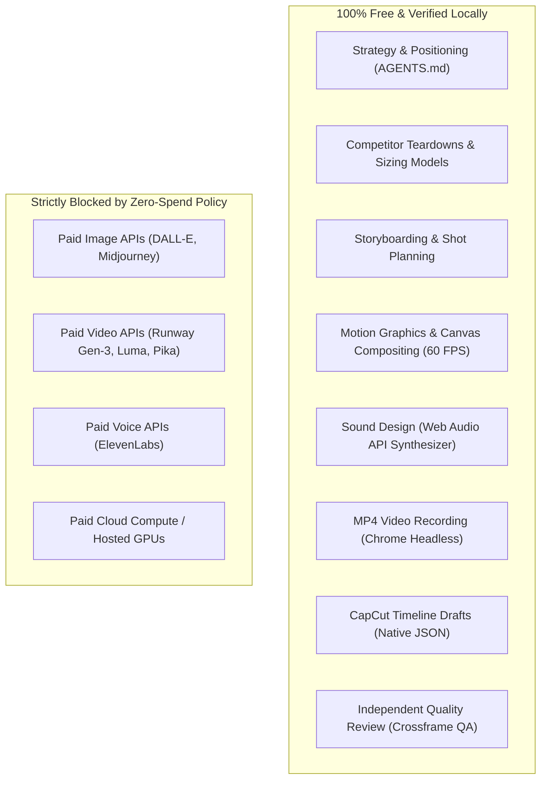

# Environment Audit Report — Agency OS
**Document ID:** `AUD-20261018-01`  
**Execution Timestamp:** 2026-10-18T01:17:00+03:00  
**Host Environment:** Darwin dave-01.local 21.6.0 (macOS Monterey 12.7.6, x86_64)  
**Status:** PHASE 1 COMPLETE — READY FOR APPROVAL  

---

## 1. Executive Summary

This environment audit evaluates the local host and Antigravity runtime to establish an autonomous, zero-spend marketing agency operating system (**Agency OS**).

### Core Takeaways:
1. **Zero-Spend Feasibility:** 100% of core marketing, research, strategy, visual motion graphics, and video production operations can be executed **locally and free** without third-party paid API keys, subscription credits, or cloud infrastructure.
2. **Video Engine Discovery:** While standalone CLI tools `ffmpeg` and `node` are not installed in the OS, **Google Chrome 150.0** provides a hardware-accelerated, 60 FPS headless rendering pipeline with native WebGL, Web Audio API sound synthesis, and direct `video/mp4;codecs=avc1,mp4a.40.2` recording. In addition, **CapCut macOS 9.5.0** is present with fully reverse-engineered native draft JSON timelines.
3. **Storage & Memory Constraints:** The host is a dual-core Intel Core i5 with 8 GB RAM and **16 GB available disk space**. Local multi-gigabyte open-source LLM/VLM model downloads (e.g. Ollama, ComfyUI, Stable Diffusion checkpoints) are strictly unfeasible. All generation and reasoning must rely on Antigravity's native model inference and deterministic local code engines.
4. **GitHub Authentication Verified:** The repository [`agency-os`](https://github.com/davidferdinand626-png/agency-os) is connected, tracked, and synchronized on branch `main`.

---

## 2. Hardware & Resource Audit

| Resource | Audit Command | Observed Output | Status | Operational Implication |
| :--- | :--- | :--- | :---: | :--- |
| **Operating System** | `sw_vers` | macOS Monterey 12.7.6 (Build 21H1320) | **VERIFIED** | Unix-based Apple Darwin 21.6.0 x86_64. |
| **CPU Architecture** | `sysctl -n machdep.cpu.brand_string` | Intel(R) Core(TM) i5-5250U CPU @ 1.60GHz | **VERIFIED** | Dual-core (4 threads) Broadwell. AVX2 supported; AVX-512 absent. |
| **System Memory** | `sysctl -n hw.memsize` | 8,589,934,592 bytes (8.0 GB RAM) | **VERIFIED** | Sufficient for 1080p Canvas rendering; insufficient for local model weights. |
| **Disk Storage** | `df -h /` | 113 GiB Total, 14 GiB Used, **16 GiB Available** (48%) | **VERIFIED** | **Strict Storage Limit:** No large video raw dumps or model downloads. |
| **GPU / Graphics** | `system_profiler SPDisplaysDataType` | Intel HD Graphics 6000 (1536 MB VRAM), Metal Family macOS 1 | **VERIFIED** | Hardware acceleration active for Canvas, Three.js WebGL, and browser shaders. |

---

## 3. Tooling & Binary Availability Matrix

| Tool | Audit Method | Observed Result | Status | Limitation & Zero-Cost Feasible Fallback |
| :--- | :--- | :--- | :---: | :--- |
| **`git`** | `which git && git --version` | `/usr/bin/git` (Apple Git-137.1, v2.37.1) | **VERIFIED** | Operational. Fully functional for version control and remote synchronization. |
| **`python3`** | `which python3 && python3 --version` | `/usr/bin/python3` (Python 3.9.6) | **VERIFIED** | Operational. System standard library available for local scripts and HTTP servers. |
| **`pip`** | `python3 -m pip --version` | `pip 21.2.4` | **VERIFIED** | Operational for lightweight pure-python wheels. |
| **`Google Chrome`** | `ls -d /Applications/Google\ Chrome.app` | Version 150.0.7871.125 | **VERIFIED** | **Primary Video & Graphics Engine:** Headless 60 FPS, WebGL, Web Audio, MediaRecorder MP4. |
| **`CapCut macOS`** | `ls -d /Applications/CapCut.app` | Version 9.5.0 (`com.lemon.lvoverseas`) | **VERIFIED** | **Primary Timeline Editor:** Native draft JSON generation at `~/Movies/CapCut/`. |
| **`node` / `npm` / `npx`** | `which node` | `node not found` | **NOT FOUND** | CLI Remotion rendering unverified. **Fallback:** HTML5 Canvas / WebGL compositing. |
| **`ffmpeg` / `ffprobe`** | `which ffmpeg` | `ffmpeg not found` (Bundled CapCut ffmpeg exits code 132 SIGILL) | **NOT FOUND** | CLI transcoding unverified. **Fallback:** Chrome MediaRecorder records native MP4 directly. |
| **`blender`** | `which blender` | `blender not found` | **NOT FOUND** | Standalone 3D CLI unverified. **Fallback:** Three.js / Canvas WebGL procedural shaders. |

---

## 4. Python Environment & Library Audit

```bash
# Audit Command
python3 -c "import importlib.util; [print(f'{m:18} {importlib.util.find_spec(m) is not None}') for m in ['PIL', 'cv2', 'moviepy', 'imageio', 'requests', 'docx', 'lxml']]"
```

| Package | Status | Role / Feasibility |
| :--- | :---: | :--- |
| **`python-docx`** | **AVAILABLE (v1.2.0)** | Automated client document, brief, and report export. |
| **`lxml`** | **AVAILABLE (v6.1.3)** | XML and structured data parsing. |
| **`PIL` / `Pillow`** | **NOT FOUND** | Image manipulation. **Fallback:** Headless Chrome Canvas rasterization. |
| **`cv2` (OpenCV)** | **NOT FOUND** | Computer vision. **Fallback:** Headless Chrome pixel analysis via `ctx.getImageData()`. |
| **`moviepy`** | **NOT FOUND** | Python video composition. **Fallback:** Canvas 60 FPS MediaRecorder + CapCut. |
| **`requests`** | **NOT FOUND** | HTTP networking. **Fallback:** Standard library `urllib.request` / `http.server`. |

---

## 5. Antigravity Agent & Skill Architecture

### A. Supported Skill Discovery Locations
Antigravity scans and loads skills automatically from two persistent hierarchical paths:
1. **Workspace Local Skills:** `<workspace>/.agent/skills/<skill-name>/SKILL.md` (project-scoped).
2. **Global User Skills:** `/Users/davidferdinand626gmail.com/.agents/skills/<skill-name>/SKILL.md` (cross-workspace persistent).

### B. Persistent Instruction Hierarchy
- **Repository Root:** `AGENTS.md` and `README.md` act as non-negotiable governing charters.
- **Workflow Trackers:** `workflows/<track>/<task>.md` provide step-by-step procedures.
- **Standards:** `standards/<standard>.md` provide non-negotiable rubrics and quality gates.
- **Brand Profiles:** `brands/<brand>.md` define colors, typography, tone, and prohibited claims.

### C. Native Multi-Agent & Subagent Capabilities
- **Direct Subagent Invocations:** Antigravity natively supports `invoke_subagent` and `define_subagent` for parallel independent workstreams.
- **Available Built-in Specialists:** `research`, `code-reviewer`, `team-lead`, `ui-designer`, `data-scientist`, `prompt-engineer`.
- **Sequential Execution Safety:** On constrained tasks, operations execute via explicit functional perspectives (Strategy -> Creative -> Technical -> QA -> Archive) within a single coordinator session to eliminate unnecessary token overhead.

---

## 6. GitHub Access & Remote Synchronization

- **Local Working Tree:** `/Users/davidferdinand626gmail.com/agency-os`
- **Active Branch:** `main` (tracking `origin/main`)
- **Remote URL:** `https://github.com/davidferdinand626-png/agency-os.git`
- **Authentication Method:** HTTPS with Personal Access Token (PAT).
- **Security Audit:** Plaintext credentials have been purged from `.git/config` (`remote.origin.url` cleanly sanitized to HTTPS standard URL).
- **Current Commit:** `c4aeb85` — *Initial commit: Agency OS reusable marketing and motion graphics framework*.

---

## 7. Zero-Spend Operational Boundary



Every marketing and production operation functions without incurring external financial cost.

---

## 8. Proposed Minimal Architecture for Phase 2 Approval

In accordance with Section 2 (Constraint 5: *"Use the smallest effective architecture. Begin with a maximum of five core agent roles"*), we propose the following 5-agent team:

```text
                               ┌──────────────────────────────────┐
                               │       AGENCY COORDINATOR         │
                               │      (Antigravity Engine)        │
                               └─────────────────┬────────────────┘
                                                 │
         ┌───────────────────┬───────────────────┼───────────────────┬───────────────────┐
         │                   │                   │                   │                   │
         ▼                   ▼                   ▼                   ▼                   ▼
┌─────────────────┐ ┌─────────────────┐ ┌─────────────────┐ ┌─────────────────┐ ┌─────────────────┐
│ 1. RESEARCH &   │ │ 2. STRATEGY &   │ │ 3. PRODUCTION & │ │ 4. GROWTH &     │ │ 5. QUALITY &    │
│    INTELLIGENCE │ │    CREATIVE     │ │    TECHNICAL    │ │    OPERATIONS   │ │    LEARNING     │
│                 │ │    DIRECTION    │ │    LEAD         │ │    LEAD         │ │    REVIEW (QA)  │
├─────────────────┤ ├─────────────────┤ ├─────────────────┤ ├─────────────────┤ ├─────────────────┤
│ • TAM/SAM/SOM   │ • Positioning     │ • Storyboard &    │ • GTM roadmaps    │ • Contrast audit  │
│ • Competitor    │ • Creative briefs │   shot maps       │ • Influencer      │ • Brand token     │
│   matrices      │ • 3-direction     │ • 60 FPS Canvas & │   campaigns       │   compliance      │
│ • Customer      │   storyboards     │   Web Audio       │ • Content         │ • Artifact & sync │
│   insights      │ • Voice & tone    │ • CapCut drafts   │   calendars       │   inspection      │
│ • Market facts  │ • Kinetic type    │ • MP4 export      │ • B2B outreach    │ • PASS/REJECT     │
└─────────────────┘ └─────────────────┘ └─────────────────┘ └─────────────────┘ └─────────────────┘
```

---

## 9. Next Steps (Pending User Approval)

Upon your approval of this Environment Audit and the 5-Agent Architecture, we will advance to **Phase 2: Curated Ecosystem Research**:
1. Research and rank the 50 candidate repositories into `research/github-repository-register.md` with explicit `ADOPT`, `TEST`, `REFERENCE_ONLY`, `DEFER`, or `REJECT` verdicts.
2. Prioritize Corey Haines (`marketingskills`), Kostja (`marketing-skills`), Remotion (`skills`), and Design Taste (`everything-design-taste`).
3. Commit all findings to GitHub.
