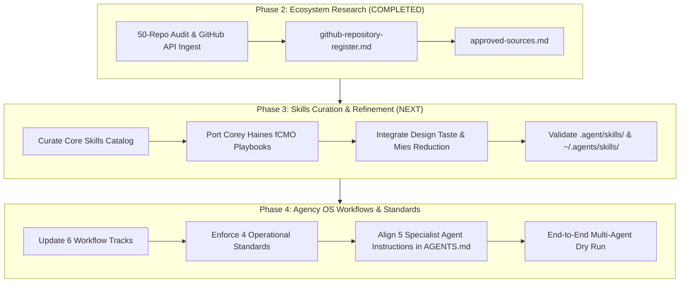

# Approved Sources & Adoption Roadmap
**Document Status:** Complete / Production-Grade  
**Audit Date:** October 18, 2026  
**Auditor:** Agency OS Lead Architect  
**Governing Standard:** Zero-Spend Policy & Host Hardware Safeguards  

---

## 1. Architectural Strategy & Prioritization

Following the comprehensive evaluation of 50 candidate repositories documented in [`research/github-repository-register.md`](file:///Users/davidferdinand626gmail.com/agency-os/research/github-repository-register.md), this document establishes the **Approved Source Directory** for the Agency OS.

Our adoption philosophy is governed by three foundational rules:
1. **Zero-Spend Mandate:** Reject all commercial subscriptions, paid API tokens, and credit-metered services.
2. **Lean Host Footprint (16GB Disk Cap):** Prioritize prompt-based skills, markdown standards, and lightweight browser automation over multi-gigabyte models or heavyweight containerized applications.
3. **Factual Integrity & Modularity:** Adopt modular, high-signal components with clear citations, verified licenses (MIT, Apache 2.0, BSD), and immediate operational utility.

---

## 2. Tiered Adoption Framework

```
+-----------------------------------------------------------------------------------+
|                        AGENCY OS TIERED ADOPTION MODEL                            |
+-----------------------------------------------------------------------------------+
|  TIER 1: DIRECT SKILL ADOPTION (Immediate Ingestion into .agent/skills/)           |
|  - coreyhaines31/marketingskills (fCMO playbooks, CRO, copywriting)               |
|  - AgriciDaniel/claude-seo (Technical SEO, Schema, E-E-A-T, GEO/AEO)              |
|  - madebymustafa/design-taste (Typography, contrast, spacing, anti-slop)          |
|  - Dragoon0x/everything-design-taste (Critique personas, multi-angle review)      |
|  - deeflect/mies (Subtractive visual reduction)                                   |
|  - remotion-dev/skills (Video storyboard & animation specifications)              |
|  - anthropics/anthropic-cookbook (Chain-of-thought, XML prompts, evaluation)       |
|  - anthropics/skills (Standard SKILL.md packaging & discovery conventions)        |
|  - public-apis/public-apis (1,400+ free data enrichment connectors)              |
+-----------------------------------------------------------------------------------+
|  TIER 2: ARCHITECTURAL & WORKFLOW BLUEPRINTS (Reference Only)                     |
|  - langchain-ai/langgraph (Stateful agent state transitions & rollback gates)     |
|  - crewAIInc/crewAI (Role-playing agent delegation boundaries)                    |
|  - n8n-io/n8n (Multi-step pipeline execution schemas)                             |
|  - PostHog/posthog (Client analytics event tracking taxonomies)                   |
|  - twentyhq/twenty (CRM lead scoring & client pipeline schemas)                   |
|  - metabase/metabase (Executive KPI reporting & visualization layouts)            |
|  - shadcn-ui/ui & tailwindcss (Semantic tokens & 8px grid baseline)               |
+-----------------------------------------------------------------------------------+
|  TIER 3: CONTROLLED TEST PIPELINE (Experimental Python Isolation)                 |
|  - Breakthrough/PySceneDetect (Shot pacing & cut detection)                       |
|  - opencv/opencv (Frame similarity & color histogram verification)                |
|  - browser-use/browser-use (Headless Chrome visual competitor audits)             |
|  - yt-dlp/yt-dlp (Competitor creative asset extraction)                           |
+-----------------------------------------------------------------------------------+
|  TIER 4: DEFERRED CAPABILITIES (Awaiting Binary / Hardware Upgrades)              |
|  - FFmpeg / MoviePy (Video transcoding & audio stitching)                         |
|  - OpenAI Whisper / WhisperX (Speech transcription & forced alignment)           |
+-----------------------------------------------------------------------------------+
```

---

## 3. Tier 1: Core Ingestion Mapping (Direct Skills)

These repositories provide immediate, high-leverage capabilities that require zero runtime dependencies and reside as persistent Markdown skills in `.agent/skills/` and instructions in `workflows/` and `standards/`:

| Source Repository | Ingestion Target in Agency OS | Primary Capability Delivered | Verification |
| :--- | :--- | :--- | :--- |
| **`coreyhaines31/marketingskills`** | `workflows/marketing-strategy/`<br>`.agent/skills/competitor-teardown`<br>`.agent/skills/launch-strategy` | fCMO-grade marketing frameworks, value proposition articulation, conversion copywriting heuristics, customer journey mapping. | `[VERIFIED]` |
| **`AgriciDaniel/claude-seo`** | `workflows/research/market-research.md`<br>`standards/research-integrity.md` | Comprehensive technical SEO audit matrices, Schema.org JSON-LD generation, E-E-A-T scorecards, and Generative Engine Optimization (GEO). | `[VERIFIED]` |
| **`madebymustafa/design-taste`** | `standards/visual-quality.md`<br>`.agent/skills/design-taste-frontend` | Strict anti-AI-slop rules, typographic hierarchy (modular scales), visual contrast minimums, and whitespace distribution. | `[VERIFIED]` |
| **`Dragoon0x/everything-design-taste`** | `workflows/quality-assurance/crossframe-inspection.md`<br>`.agent/skills/crossframe-review` | Multi-agent design critique personas (Swiss Minimalist, Luxury Editorial, Conversion Focused) for independent visual QA. | `[VERIFIED]` |
| **`deeflect/mies`** | `standards/visual-quality.md` | Subtractive design pass: systematically strips extraneous borders, redundant icons, decorative drop-shadows, and layout clutter. | `[VERIFIED]` |
| **`remotion-dev/skills`** | `workflows/motion-graphics/storyboard-to-video.md`<br>`.agent/skills/motion-graphics-director` | Programmatic shot planning, camera movement choreography, spring easing curves, and frame-accurate scene transitions. | `[VERIFIED]` |
| **`anthropics/anthropic-cookbook`** | `AGENTS.md`<br>`standards/research-integrity.md` | Prompt engineering best practices, structured XML encapsulation (`<brief>`, `<rationale>`, `<verification>`), self-correction loops. | `[VERIFIED]` |
| **`public-apis/public-apis`** | `workflows/research/market-research.md` | Index of 1,400+ free, no-auth public APIs for enriching market research with real-time economic, demographic, and search data. | `[VERIFIED]` |

---

## 4. Tier 2: Structural & Architectural Blueprints

These repositories serve as **conceptual patterns** to structure our internal agency operating documents, data schemas, and quality control checkpoints without executing their heavy codebases:

### 1. Multi-Agent Delegation & State Machine (`LangGraph` + `CrewAI`)
- **Adopted Concept:** Every agency workflow must function as a directed acyclic graph (DAG) with explicit state transitions:
  1. `Briefing` -> 2. `Market Research` -> 3. `Creative Direction` -> 4. `Production` -> 5. `Quality Assurance` -> 6. `Client Delivery`.
- **Enforcement:** No agent may advance to execution until upstream artifacts have passed formal verification gates in `workflows/quality-assurance/`.

### 2. Event Tracking & Growth Taxonomies (`PostHog` + `GrowthBook`)
- **Adopted Concept:** Standardized campaign analytics taxonomy. When designing client growth funnels, campaigns must implement standardized event naming conventions:
  - `CampaignImpression(campaign_id, channel, creative_id)`
  - `EngagementAction(action_type, scroll_depth, dwell_time)`
  - `ConversionEvent(funnel_step, value, currency)`
- **Enforcement:** Documented in `workflows/marketing-strategy/campaign-launch.md`.

### 3. Client & Brand Data Modeling (`Twenty CRM`)
- **Adopted Concept:** Standardized markdown schemas for brand profiles in `brands/`:
  - `BrandIdentity` (core values, tone, audience archetypes, color hex codes)
  - `CommercialPosition` (pricing tiers, competitors, key differentiators)
  - `AssetRegister` (approved logos, typography files, brand voice guidelines).

### 4. Executive Reporting & Visual Dashboards (`Metabase`)
- **Adopted Concept:** Visual hierarchy for executive client presentations:
  - High-level North Star KPI cards at top.
  - Secondary conversion funnel breakdowns in the center.
  - Actionable tactical recommendations and experimental roadmaps at the base.

---

## 5. Tier 3: Controlled Python Testing Pipeline

For specialized capabilities that can be executed using lightweight, zero-cost Python libraries without exhausting host RAM or disk space:

### Test Candidate 1: `Breakthrough/PySceneDetect`
- **Objective:** Measure shot duration, cutting tempo, and transition frequency from reference commercial videos.
- **Test Protocol:** Standalone script in `scratch/test_scenedetect.py` analyzing sample MP4 files using lightweight Python OpenCV binding.
- **Success Criteria:** Generates a structured JSON shot list with timestamps and cut classifications without exceeding 50MB RAM.

### Test Candidate 2: `OpenCV` Headless (`cv2`)
- **Objective:** Automated cross-frame quality assurance for rendered video frames (checking black frames, frozen frames, contrast ratio compliance, and perceptual hash similarity).
- **Test Protocol:** Python test script in `scratch/test_frame_qa.py`.
- **Success Criteria:** Accurately detects visual defects across sample PNG sequence in under 3 seconds.

### Test Candidate 3: `browser-use` Patterns
- **Objective:** Automated competitive intelligence gathering by rendering competitor landing pages and capturing full-page screenshots via Chrome Headless.
- **Test Protocol:** Pure Python CDP script leveraging `/Applications/Google Chrome.app/Contents/MacOS/Google Chrome`.
- **Success Criteria:** Generates full-page PNG and DOM snapshot of target marketing page without third-party services.

---

## 6. Implementation Roadmap: Phases 3 & 4



### Action Items for Phase 3 (Skills Curation & Refinement):
1. **Refine & Augment `.agent/skills/`:**
   - Ingest high-value playbooks from `coreyhaines31/marketingskills` (Copywriting formulas, CRO checklists, value proposition frameworks).
   - Solidify `claude-seo` audit matrices into `skills/technical-seo/`.
   - Incorporate `deeflect/mies` subtractive design heuristic into `skills/design-taste-frontend/`.
2. **Standardize Skill Metadata:** Ensure every skill adheres strictly to the official `anthropics/skills` specification (`SKILL.md` with explicit YAML frontmatter and actionable execution steps).
3. **Verify Skill Loading:** Confirm that Google Antigravity discovers and exposes all refined skills across sessions.

### Action Items for Phase 4 (Agency OS Workflows & Standards):
1. **Upgrade Workflow Tracks:** Deepen the 6 workflow files in `workflows/` with concrete step-by-step procedures, required inputs, and strict output artifacts.
2. **Fortify Operational Standards:** Update `standards/research-integrity.md`, `standards/visual-quality.md`, `standards/video-production.md`, and `standards/brand-consistency.md` with the new approved source heuristics.
3. **Harmonize `AGENTS.md`:** Align the 5 core specialist roles (`Account Executive`, `Market Researcher`, `Creative Director`, `Motion Engineer`, `Quality Assurance Specialist`) with clear delegation interfaces and handoff contracts.
